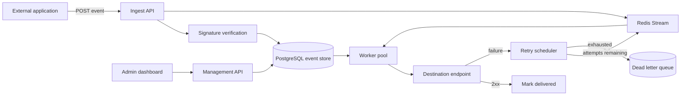

# EventRelay

> Self-hosted webhook infrastructure with reliable delivery, event replay, retries and observability.


[](LICENSE)


**Status: skeleton (v0.0.0).** This repository contains the project structure, architecture decisions and
an implementation plan. **Nothing is functional yet.** The word "works" does not appear below unless it is
true.

## Why this exists

Sending a webhook is easy for one request and hard for a million. Every team that emits events
eventually rebuilds the same machinery: retries with backoff, a dead-letter queue, replay, signature
verification, delivery history and per-tenant isolation. Hosted options exist; a self-hosted one that you
can read end to end does not really exist as a mature open-source project. EventRelay is that project.

## What it will do

| Capability | Milestone | Status |
|---|---|---|
| Multi-tenant webhook endpoints | M5 | Not started |
| Event ingestion and persistence | M1 | Not started |
| HMAC signature verification | M1 | Not started |
| Asynchronous delivery workers | M2 | Not started |
| Configurable retry policies | M3 | Not started |
| Dead-letter queue | M3 | Not started |
| Request inspection and delivery history | M4 | Not started |
| Manual event replay | M4 | Not started |
| API key management | M5 | Not started |
| OpenAPI documentation | M1 | Not started |
| Per-tenant rate limits | M5 | Not started |
| Horizontal worker scaling | M2 | Not started |
| Idempotency keys | M5 | Not started |
| Event ordering options | M6 | Not started |
| Distributed tracing | M6 | Not started |
| Backpressure handling | M6 | Not started |

## Architecture



Full reasoning, data model, API surface and failure behaviour are in [docs/PLAN.md](docs/PLAN.md).

## Engineering challenge

Guaranteeing safe retry behaviour without duplicate side effects. The system is at-least-once
and says so everywhere. Duplicate suppression is the consumer's job, and EventRelay makes that cheap by
keeping event_id stable across every attempt.

## Quickstart

Not runnable yet. The skeleton builds and prints its version:

```bash
make build
./bin/eventrelay version
```

Full local stack (Postgres, Redis, API, workers) arrives with
milestone M1.

## Repository layout

| Path | Purpose |
|---|---|
| `cmd/eventrelay` | API server entry point |
| `cmd/worker` | Delivery worker entry point |
| `internal/ingest` | HTTP handler, signature verification, validation, persistence |
| `internal/delivery` | HTTP delivery, attempt recording, result classification |
| `internal/store` | PostgreSQL access, queries, migrations runner |
| `internal/retry` | Backoff schedule, scheduling, dead-letter promotion |
| `internal/auth` | API keys and tenant resolution |
| `pkg/hmacsign` | Public signing and verification helpers, safe to import |
| `api/openapi.yaml` | OpenAPI 3.1 contract; only implemented paths appear |
| `migrations` | Forward-only SQL migrations |
| `web` | React dashboard (M4) |
| `deploy` | Compose file and deployment notes |
| `tests` | Integration, load and benchmark suites |

## Roadmap

| Milestone | Deliverable | Status |
|---|---|---|
| M1 | HTTP ingestion API and durable event storage | Not started |
| M2 | Redis Streams transport, worker pool, horizontal scaling | Not started |
| M3 | Retry scheduler and dead-letter queue | Not started |
| M4 | Dashboard, request inspection and manual replay | Not started |
| M5 | Multi-tenancy, API keys, rate limits, idempotency | Not started |
| M6 | Ordering options, tracing, backpressure, load test report, docs | Not started |

This roadmap mirrors [docs/PLAN.md](docs/PLAN.md) section 12. If the two disagree, the plan is correct and
the README is a bug.

## Project standards

- Conventional Commits, Semantic Versioning, `main` is always green.
- Every release is produced by CI, never by a laptop.
- Status claims must match reality. Unbuilt features are marked "Not started", not "coming soon".
- Decisions are recorded as ADRs in [docs/adr/](docs/adr/).

## Contributing

Read [CONTRIBUTING.md](CONTRIBUTING.md) and [docs/PLAN.md](docs/PLAN.md) first. Issues labelled
`good first issue` are scoped for a first pull request.

## Using an AI assistant on this repository

Read [docs/PLAN.md](docs/PLAN.md) end to end, including the machine context block at the top. It states
what exists, what does not, and which claims are forbidden. Do not describe planned behaviour as
implemented behaviour.

## License

Apache License 2.0 - see [LICENSE](LICENSE).
