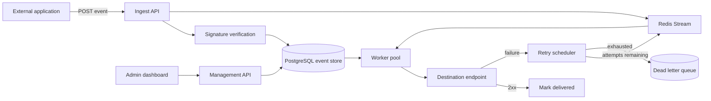
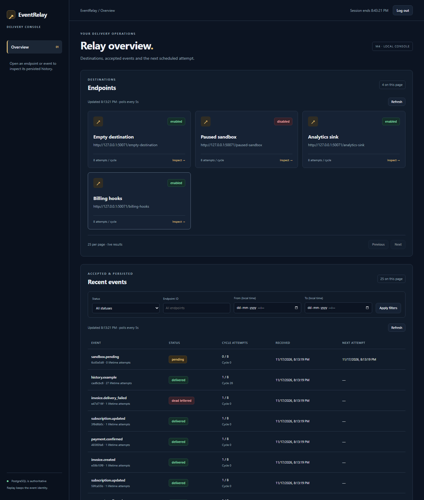

# EventRelay

> Self-hosted webhook infrastructure with reliable delivery, event replay, retries and observability.


[](LICENSE)


**Status: M1–M3 complete and merged into main.** Signed events are stored durably and dispatched through Redis Streams to
independently scaled HTTP workers. Delivery is at least once: destinations must deduplicate by event ID.
Retries follow the documented backoff schedule with jitter and `Retry-After`, and dead letters carry a
stable terminal reason ([ADR 0005](docs/adr/0005-m3-retry-policy.md)).
M4 inspection, endpoint recovery, guarded replay and the React dashboard are implemented and verified
locally on `feat/m4-implementation`; publication and branch CI are pending.

## Why this exists

Sending a webhook is easy for one request and hard for a million. Every team that emits events
eventually rebuilds the same machinery: retries with backoff, a dead-letter queue, replay, signature
verification, delivery history and per-tenant isolation. Hosted options exist; a self-hosted one that you
can read end to end does not really exist as a mature open-source project. EventRelay is that project.

## What it will do

| Capability | Milestone | Status |
|---|---|---|
| Multi-tenant webhook endpoints | M5 | Not started |
| Event ingestion and persistence | M1 | **Done** |
| HMAC signature verification | M1 | **Done** |
| Asynchronous delivery workers | M2 | **Done (merged)** |
| Documented retry policy | M3 | **Done (merged)**; fixed schedule — ADR 0005 |
| Full dead-letter policy and terminal reasons | M3 | **Done (merged)** |
| Request inspection and delivery history | M4 | **Implemented; verified locally** |
| Manual event replay | M4 | **Implemented; verified locally** |
| Endpoint recovery and dashboard | M4 | **Implemented; verified locally** |
| API key management | M5 | Not started |
| OpenAPI documentation | M1 | **Done** (implemented paths only) |
| Per-tenant rate limits | M5 | Not started |
| Horizontal worker scaling | M2 | **Done (merged)** |
| Idempotency keys | M5 | Not started (header accepted, ignored) |
| Event ordering options | M6 | Not started |
| Distributed tracing | M6 | Not started |
| Backpressure handling | M6 | Not started |

## Architecture



Full reasoning, data model, API surface and failure behaviour are in [docs/PLAN.md](docs/PLAN.md).

## Engineering challenge

Guaranteeing safe retry behaviour without duplicate side effects. The system is at-least-once
and says so everywhere. Duplicate suppression is the consumer's job, and EventRelay makes that cheap by
keeping event_id stable across every attempt.

## Quickstart

Requires Docker. Start the API, PostgreSQL, Redis and four worker processes:

```bash
export EVENTRELAY_ADMIN_TOKEN='dev-admin-token-change-me'
docker compose -f deploy/docker-compose.yml up -d --build --scale worker=4
```

The schema is applied on start. Create an endpoint — the two secrets are printed once and never again:

```bash
curl -s -X POST http://localhost:8080/v1/endpoints \
  -H "Authorization: Bearer $EVENTRELAY_ADMIN_TOKEN" \
  -H 'Content-Type: application/json' \
  -d '{"url":"https://example.com/hooks/orders"}'
```

Send a signed event. The signature covers the exact raw body:

```bash
# Decode the base64 ingest_secret returned by endpoint creation into hex.
INGEST_SECRET_HEX=$(printf '%s' "$INGEST_SECRET" | openssl base64 -d -A | od -An -v -tx1 | tr -d ' \n')
BODY='{"order_id":"8891","total":4200}'
TS=$(date +%s)
SIG=$(printf 'v1:%s:%s' "$TS" "$BODY" | openssl dgst -sha256 -mac HMAC -macopt "hexkey:$INGEST_SECRET_HEX" -r | cut -d' ' -f1)

curl -i -X POST "http://localhost:8080/v1/endpoints/$ENDPOINT_ID/events" \
  -H "X-EventRelay-Signature: t=$TS,v1=$SIG" \
  -H 'X-Event-Type: order.created' \
  -H 'Content-Type: application/json' \
  -d "$BODY"
```

`202 Accepted` means the event is stored as `pending`. Read it back:

```bash
curl -s http://localhost:8080/v1/events \
  -H "Authorization: Bearer $EVENTRELAY_ADMIN_TOKEN"
```

Two things to know about the stored payload: it is a `jsonb` column, so PostgreSQL re-serialises it and key
order plus whitespace will differ from what you sent. Signature verification always uses the raw request
bytes, so this does not weaken the check.

Workers sign the stored JSON with the separate delivery secret. Private and loopback destinations are
blocked unless `EVENTRELAY_ALLOW_PRIVATE_TARGETS=true` is explicitly set for local testing. Redirects are
never followed. Inspect persisted attempts through the management API:

```bash
curl -s "http://localhost:8080/v1/events/$EVENT_ID/attempts?limit=50" \
  -H "Authorization: Bearer $EVENTRELAY_ADMIN_TOKEN"
```

See [the runnable delivery demo](deploy/README.md) and [M2 decisions](docs/adr/0004-m2-delivery.md).
The [recorded four-process load run](docs/benchmarks/m2-delivery.md) delivered 10,000 events in 58.84 s.
See [validation and limits](docs/testing/m1-m2-validation.md) before interpreting the result.

## Inspection and replay dashboard

Open [http://localhost:8080/dashboard/](http://localhost:8080/dashboard/) and enter the configured
management token. The Go API serves the committed React assets; Node is needed only to develop/rebuild
the frontend. The browser uses an HttpOnly session cookie and an in-memory CSRF nonce. Sessions expire
after 30 minutes and end on logout or API restart.

The console filters recent events, pages through attempts and previous delivery cycles, and lets you
correct/re-enable an endpoint. Replay accepts delivered or dead-lettered events and preserves their ID,
payload and lifetime history while starting a fresh bounded delivery cycle. Confirming a delivered
event's replay can repeat an effect at the destination. A stale replay or endpoint revision returns a
conflict that requires refreshing before another action.

Statistics show successful HTTP-response attempts divided by all HTTP-response attempts in a stated
24-hour UTC window. No-response attempts have separate counts. Empty denominators and exceeded query
bounds are explicitly unavailable. Response bodies and headers were never archived and remain unavailable.



This screenshot was captured from the implemented local dashboard using synthetic fixtures. Read the
[dashboard/API and M3 upgrade guide](docs/guides/inspection-and-replay.md) and
[M4 validation record](docs/testing/m4-inspection-replay-dashboard.md) for usage, bounds and remaining gates.

## Repository layout

| Path | Purpose |
|---|---|
| `cmd/eventrelay` | API server entry point |
| `cmd/worker` | Delivery worker entry point |
| `internal/ingest` | HTTP handler, signature verification, validation, persistence |
| `internal/config` | Environment parsing and validation |
| `internal/observability` | Structured logging and Prometheus metrics |
| `internal/httpx` | RFC 9457 problem documents and JSON responses |
| `internal/delivery` | Signed HTTP delivery and result classification |
| `internal/stream` | Bounded Redis dispatch and pending-entry cleanup |
| `internal/worker` | Lease, delivery, completion and recovery loops |
| `internal/store` | PostgreSQL access, queries, migrations runner |
| `internal/retry` | Retry schedule, jitter, Retry-After parsing and terminal decisions (ADR 0005) |
| `internal/dashboard` | Embedded, reproducibly built dashboard assets |
| `internal/auth` | API keys and tenant resolution (empty until M5) |
| `pkg/hmacsign` | Public signing and verification helpers, safe to import |
| `api/openapi.yaml` | OpenAPI 3.1 contract; only implemented paths appear |
| `api/dashboard.openapi.yaml` | Browser session and dashboard API contract |
| `migrations` | Forward-only SQL migrations |
| `web` | React dashboard (M4) |
| `deploy` | Compose file and deployment notes |
| `tests` | Integration, load and benchmark suites |

## Roadmap

M3 merged through [PR #3](https://github.com/Shellghostt/EventRelay/pull/3), with recorded
[acceptance evidence](docs/testing/m3-retry-policy.md) and successful
[main CI](https://github.com/Shellghostt/EventRelay/actions/runs/43802341943).
The [audit correction record](docs/testing/m3-audit-fixes.md) covers five additional regressions
and successful native Windows race and bounded load checks.
Read the [M3 requirements and acceptance gates](docs/phases/M3.md) for the phase contract and
the [development-tool audit](docs/DEVELOPMENT-TOOLS.md) before debugging.
M4 follows the updated [phase requirements](docs/phases/M4.md) and accepted
[replay/inspection ADR](docs/adr/0006-m4-replay-and-inspection.md). Its
[local validation](docs/testing/m4-inspection-replay-dashboard.md) includes native Windows race,
real PostgreSQL/Redis integration, browser checks and a bounded load regression. M4 branch CI and the
physical Redis container-restart scenario remain open; M4 has not been pushed or merged.

| Milestone | Deliverable | Status |
|---|---|---|
| M1 | HTTP ingestion API and durable event storage | **Done** (v0.1.0) |
| M2 | Redis Streams transport, worker pool, horizontal scaling | **Done (merged)** |
| M3 | Retry scheduler and dead-letter queue | **Done (merged)** |
| M4 | Dashboard, request inspection and manual replay | **Implemented; verified locally; publication/CI pending** |
| M5 | Multi-tenancy, API keys, rate limits, idempotency | Not started |
| M6 | Ordering options, tracing, backpressure, load test report, docs | Not started |

This roadmap mirrors [docs/PLAN.md](docs/PLAN.md) section 12. If the two disagree, the plan is correct and
the README is a bug.

## Project standards

- Conventional Commits, Semantic Versioning, `main` is always green.
- Every release is produced by CI, never by a laptop.
- Status claims must match reality. Unbuilt features are marked "Not started", not "coming soon".
- Decisions are recorded as ADRs in [docs/adr/](docs/adr/).

## Contributing

Read [CONTRIBUTING.md](CONTRIBUTING.md) and [docs/PLAN.md](docs/PLAN.md) first. Issues labelled
`good first issue` are scoped for a first pull request.

## Using an AI assistant on this repository

Read [docs/PLAN.md](docs/PLAN.md) end to end, including the machine context block at the top. It states
what exists, what does not, and which claims are forbidden. Do not describe planned behaviour as
implemented behaviour.

## License

Apache License 2.0 - see [LICENSE](LICENSE).
