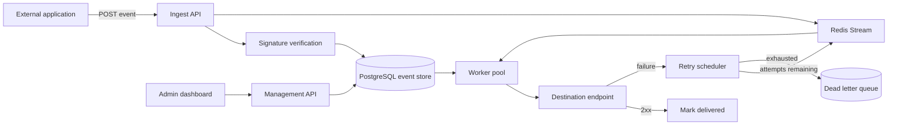

# EventRelay

> Self-hosted webhook infrastructure with reliable delivery, event replay, retries and observability.


[](LICENSE)


**Status: M2 (unreleased).** Signed events are stored durably and dispatched through Redis Streams to
independently scaled HTTP workers. Delivery is at least once: destinations must deduplicate by event ID.
M2 uses a fixed 10-second retry delay and caps attempts; the full backoff and Retry-After policy is M3.

## Why this exists

Sending a webhook is easy for one request and hard for a million. Every team that emits events
eventually rebuilds the same machinery: retries with backoff, a dead-letter queue, replay, signature
verification, delivery history and per-tenant isolation. Hosted options exist; a self-hosted one that you
can read end to end does not really exist as a mature open-source project. EventRelay is that project.

## What it will do

| Capability | Milestone | Status |
|---|---|---|
| Multi-tenant webhook endpoints | M5 | Not started |
| Event ingestion and persistence | M1 | **Done** |
| HMAC signature verification | M1 | **Done** |
| Asynchronous delivery workers | M2 | **Done (unreleased)** |
| Configurable retry policies | M3 | Not started |
| Dead-letter queue | M3 | Not started |
| Request inspection and delivery history | M4 | Not started |
| Manual event replay | M4 | Not started |
| API key management | M5 | Not started |
| OpenAPI documentation | M1 | **Done** (implemented paths only) |
| Per-tenant rate limits | M5 | Not started |
| Horizontal worker scaling | M2 | **Done (unreleased)** |
| Idempotency keys | M5 | Not started (header accepted, ignored) |
| Event ordering options | M6 | Not started |
| Distributed tracing | M6 | Not started |
| Backpressure handling | M6 | Not started |

## Architecture



Full reasoning, data model, API surface and failure behaviour are in [docs/PLAN.md](docs/PLAN.md).

## Engineering challenge

Guaranteeing safe retry behaviour without duplicate side effects. The system is at-least-once
and says so everywhere. Duplicate suppression is the consumer's job, and EventRelay makes that cheap by
keeping event_id stable across every attempt.

## Quickstart

Requires Docker. Start the API, PostgreSQL, Redis and four worker processes:

```bash
export EVENTRELAY_ADMIN_TOKEN='dev-admin-token-change-me'
docker compose -f deploy/docker-compose.yml up -d --build --scale worker=4
```

The schema is applied on start. Create an endpoint — the two secrets are printed once and never again:

```bash
curl -s -X POST http://localhost:8080/v1/endpoints \
  -H "Authorization: Bearer $EVENTRELAY_ADMIN_TOKEN" \
  -H 'Content-Type: application/json' \
  -d '{"url":"https://example.com/hooks/orders"}'
```

Send a signed event. The signature covers the exact raw body:

```bash
# Decode the base64 ingest_secret returned by endpoint creation into hex.
INGEST_SECRET_HEX=$(printf '%s' "$INGEST_SECRET" | openssl base64 -d -A | od -An -v -tx1 | tr -d ' \n')
BODY='{"order_id":"8891","total":4200}'
TS=$(date +%s)
SIG=$(printf 'v1:%s:%s' "$TS" "$BODY" | openssl dgst -sha256 -mac HMAC -macopt "hexkey:$INGEST_SECRET_HEX" -r | cut -d' ' -f1)

curl -i -X POST "http://localhost:8080/v1/endpoints/$ENDPOINT_ID/events" \
  -H "X-EventRelay-Signature: t=$TS,v1=$SIG" \
  -H 'X-Event-Type: order.created' \
  -H 'Content-Type: application/json' \
  -d "$BODY"
```

`202 Accepted` means the event is stored as `pending`. Read it back:

```bash
curl -s http://localhost:8080/v1/events \
  -H "Authorization: Bearer $EVENTRELAY_ADMIN_TOKEN"
```

Two things to know about the stored payload: it is a `jsonb` column, so PostgreSQL re-serialises it and key
order plus whitespace will differ from what you sent. Signature verification always uses the raw request
bytes, so this does not weaken the check.

Workers sign the stored JSON with the separate delivery secret. Private and loopback destinations are
blocked unless `EVENTRELAY_ALLOW_PRIVATE_TARGETS=true` is explicitly set for local testing. Redirects are
never followed. Inspect attempts with SQL until the M4 inspection API arrives:

```sql
SELECT event_id, attempt_no, outcome, response_status, duration_ms
FROM delivery_attempts ORDER BY id;
```

See [the runnable delivery demo](deploy/README.md) and [M2 decisions](docs/adr/0004-m2-delivery.md).
The [recorded four-process load run](docs/benchmarks/m2-delivery.md) delivered 10,000 events in 58.84 s.
See [validation and limits](docs/testing/m1-m2-validation.md) before interpreting the result.

## Repository layout

| Path | Purpose |
|---|---|
| `cmd/eventrelay` | API server entry point |
| `cmd/worker` | Delivery worker entry point |
| `internal/ingest` | HTTP handler, signature verification, validation, persistence |
| `internal/config` | Environment parsing and validation |
| `internal/observability` | Structured logging and Prometheus metrics |
| `internal/httpx` | RFC 9457 problem documents and JSON responses |
| `internal/delivery` | Signed HTTP delivery and result classification |
| `internal/stream` | Bounded Redis dispatch and pending-entry cleanup |
| `internal/worker` | Lease, delivery, completion and recovery loops |
| `internal/store` | PostgreSQL access, queries, migrations runner |
| `internal/retry` | Backoff schedule, scheduling, dead-letter promotion (empty until M3) |
| `internal/auth` | API keys and tenant resolution (empty until M5) |
| `pkg/hmacsign` | Public signing and verification helpers, safe to import |
| `api/openapi.yaml` | OpenAPI 3.1 contract; only implemented paths appear |
| `migrations` | Forward-only SQL migrations |
| `web` | React dashboard (M4) |
| `deploy` | Compose file and deployment notes |
| `tests` | Integration, load and benchmark suites |

## Roadmap

| Milestone | Deliverable | Status |
|---|---|---|
| M1 | HTTP ingestion API and durable event storage | **Done** (v0.1.0) |
| M2 | Redis Streams transport, worker pool, horizontal scaling | **Done (unreleased)** |
| M3 | Retry scheduler and dead-letter queue | Not started |
| M4 | Dashboard, request inspection and manual replay | Not started |
| M5 | Multi-tenancy, API keys, rate limits, idempotency | Not started |
| M6 | Ordering options, tracing, backpressure, load test report, docs | Not started |

This roadmap mirrors [docs/PLAN.md](docs/PLAN.md) section 12. If the two disagree, the plan is correct and
the README is a bug.

## Project standards

- Conventional Commits, Semantic Versioning, `main` is always green.
- Every release is produced by CI, never by a laptop.
- Status claims must match reality. Unbuilt features are marked "Not started", not "coming soon".
- Decisions are recorded as ADRs in [docs/adr/](docs/adr/).

## Contributing

Read [CONTRIBUTING.md](CONTRIBUTING.md) and [docs/PLAN.md](docs/PLAN.md) first. Issues labelled
`good first issue` are scoped for a first pull request.

## Using an AI assistant on this repository

Read [docs/PLAN.md](docs/PLAN.md) end to end, including the machine context block at the top. It states
what exists, what does not, and which claims are forbidden. Do not describe planned behaviour as
implemented behaviour.

## License

Apache License 2.0 - see [LICENSE](LICENSE).
