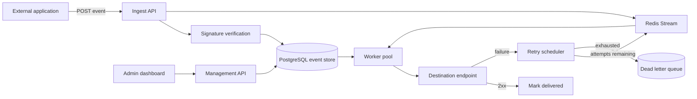

# EventRelay Architecture

**Status: M1–M3 merged; M4 implemented and verified locally.** M4 adds inspection, endpoint recovery,
replay and an embedded dashboard on `feat/m4-implementation`; publication/CI are pending. Tenancy and
API keys remain M5. See [ADR 0004](adr/0004-m2-delivery.md), [ADR 0005](adr/0005-m3-retry-policy.md)
and accepted [ADR 0006](adr/0006-m4-replay-and-inspection.md).

## Context

Self-hosted webhook infrastructure with reliable delivery, event replay, retries and observability.

Sending a webhook is easy for one request and hard for a million. Every team that emits events
eventually rebuilds the same machinery: retries with backoff, a dead-letter queue, replay, signature
verification, delivery history and per-tenant isolation. Hosted options exist; a self-hosted one that you
can read end to end does not really exist as a mature open-source project. EventRelay is that project.

## Current shape

## Component responsibilities

See [PLAN.md](PLAN.md) section 6 for the responsibility of each box, the request and event flows, and the
failure behaviour of each stage.

The implemented M2 path is API → PostgreSQL commit → bounded Redis stream → worker → signed HTTP.
A lease and its attempt row are committed before HTTP begins. PostgreSQL fences completion with the
random token, attempt number and lease expiry checked after acquiring the row lock. The attempt closes
in the same transaction that marks delivery, persists the M3 retry decision or records a dead letter.

Each worker process runs a finite number of delivery goroutines and one sweeper. The sweeper closes
expired attempts and republishes bounded pages of due events. Redis messages contain tenant/event IDs;
they are acknowledged after claim, and missing/duplicate messages are resolved from the durable state.
Redis consumer metadata uses one shared consumer identity; exclusivity comes from PostgreSQL row leases.

HTTP destinations are checked at DNS resolution and the selected IP is dialed directly. No redirects or
environment proxies are followed. Headers, response reads, HTTP time and database operations are bounded.
Response content is discarded. Readiness checks both backing services; liveness is independent of them.

The management API and embedded React dashboard read persisted delivery evidence. M3 replaces the M2 fixed 10-second
retries with the documented schedule, jitter, Retry-After and stable terminal reasons
([ADR 0005](adr/0005-m3-retry-policy.md)). M2 tests and measured limits are recorded in
[testing/m1-m2-validation.md](testing/m1-m2-validation.md); M3 acceptance evidence is recorded in
[testing/m3-retry-policy.md](testing/m3-retry-policy.md).

## What is deliberately absent

See [PLAN.md](PLAN.md) section 4 (non-goals). If a component is not on that diagram, it is not part of the
design.

## M3

M3 (retry policy and dead-letter handling) is merged through
[PR #3](https://github.com/Shellghostt/EventRelay/pull/3) under
[ADR 0005](adr/0005-m3-retry-policy.md) with acceptance evidence in
[testing/m3-retry-policy.md](testing/m3-retry-policy.md); the
[phase requirements](phases/M3.md) hold the contract, and [development tools](DEVELOPMENT-TOOLS.md)
record actual tooling coverage.

## M4 inspection and replay

[ADR 0006](adr/0006-m4-replay-and-inspection.md) separates a frozen cycle budget from monotonic lifetime
attempt numbering. Migration 0004 maps M3 rows into cycle zero. Replay locks the owned event, then its
endpoint, checks terminal state and `expected_replay_count`, archives the previous cycle, removes active
DLQ membership and persists pending/due state in one transaction. The next worker claim creates the HTTP
attempt. Durable sweep publication recovers an accepted replay when Redis connectivity returns.

Claims snapshot/share-lock endpoint configuration. Endpoint PATCH requires `expected_revision` and
increments that revision; a completion from an earlier destination cannot disable a corrected revision
on HTTP 410. PATCH changes URL/enabled state, while each cycle retains its original attempt budget.

All delivery transitions set a transaction-local M4 marker. A migration trigger rejects old worker
claims/completion/recovery after cutover. Stop/drain M3 binaries before applying 0004; the
[upgrade guide](guides/inspection-and-replay.md#m3-to-m4-upgrade) describes the supported sequence.

Inspection queries have two-second deadlines, default 50/max 200-item pages, 2,048-character diagnostics
and a 1-MiB JSON response limit. Detail payloads over 512 KiB are explicitly unavailable. Legacy lists
retain their contracts; the browser uses payload-free event summaries and opt-in endpoint pagination.
New cursors bind route, tenant and canonical parsed filters. Pages show live membership, with stable
ordering for unchanged rows.

Endpoint statistics use persisted finished attempts in `[database-now - 24h, database-now)`. Success rate
is successful HTTP-response attempts divided by all HTTP-response attempts, including replay cycles.
The indexed query materializes at most 100,001 matching rows and returns unavailable above 100,000.
Response content is discarded, and inspection never probes a destination.

The API embeds committed frontend assets under `/dashboard/`. Login exchanges the management token for
a bounded server-side session with a separate CSRF nonce; unsafe requests check the exact origin and
nonce. Sessions expire after 30 minutes, revoke on logout and disappear on restart. The cookie does not
authorize the bearer API or ingestion. The client cancels navigation requests, suppresses stale results,
polls five seconds after completion, pauses hidden tabs and caps cursor history at 20 entries.

[M4 requirements](phases/M4.md), the [usage guide](guides/inspection-and-replay.md) and
[local validation](testing/m4-inspection-replay-dashboard.md) record implemented behavior and remaining
acceptance gates. Distributed sessions and production deployment remain outside M4.
