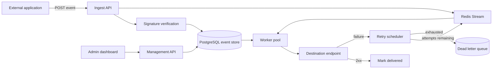

# EventRelay Architecture

**Status: partially implemented (M2).** Ingestion, Redis transport and HTTP delivery exist.
Full retry policy, replay, tenancy and the dashboard remain planned. See [ADR 0004](adr/0004-m2-delivery.md).

## Context

Self-hosted webhook infrastructure with reliable delivery, event replay, retries and observability.

Sending a webhook is easy for one request and hard for a million. Every team that emits events
eventually rebuilds the same machinery: retries with backoff, a dead-letter queue, replay, signature
verification, delivery history and per-tenant isolation. Hosted options exist; a self-hosted one that you
can read end to end does not really exist as a mature open-source project. EventRelay is that project.

## Intended shape

## Component responsibilities

See [PLAN.md](PLAN.md) section 6 for the responsibility of each box, the request and event flows, and the
failure behaviour of each stage.

The implemented M2 path is API → PostgreSQL commit → bounded Redis stream → worker → signed HTTP.
A lease and its attempt row are committed before HTTP begins. PostgreSQL fences completion with the
random token, attempt number and lease expiry checked after acquiring the row lock. The attempt closes
in the same transaction that marks delivery, schedules a fixed-delay retry or records a dead letter.

Each worker process runs a finite number of delivery goroutines and one sweeper. The sweeper closes
expired attempts and republishes bounded pages of due events. Redis messages contain tenant/event IDs;
they are acknowledged after claim, and missing/duplicate messages are resolved from the durable state.
Redis consumer metadata uses one shared consumer identity; exclusivity comes from PostgreSQL row leases.

HTTP destinations are checked at DNS resolution and the selected IP is dialed directly. No redirects or
environment proxies are followed. Headers, response reads, HTTP time and database operations are bounded.
Response content is discarded. Readiness checks both backing services; liveness is independent of them.

The diagram also shows planned management and dashboard components. M2 provides fixed 10-second
retries, not the M3 exponential policy. Tests and measured limits are recorded in
[testing/m1-m2-validation.md](testing/m1-m2-validation.md).

## What is deliberately absent

See [PLAN.md](PLAN.md) section 4 (non-goals). If a component is not on that diagram, it is not part of the
design.
