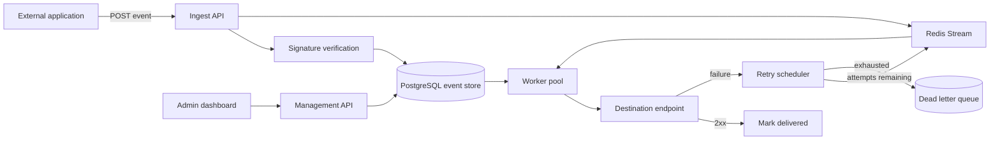

# EventRelay Architecture

**Status: partially implemented (M1).** The ingestion path described here exists; delivery, the Redis
transport and the dashboard do not. This document describes intended structure, not delivered behaviour. The
authoritative specification is [PLAN.md](PLAN.md), and section 0 there is the current truth.

## Context

Self-hosted webhook infrastructure with reliable delivery, event replay, retries and observability.

Sending a webhook is easy for one request and hard for a million. Every team that emits events
eventually rebuilds the same machinery: retries with backoff, a dead-letter queue, replay, signature
verification, delivery history and per-tenant isolation. Hosted options exist; a self-hosted one that you
can read end to end does not really exist as a mature open-source project. EventRelay is that project.

## Intended shape

## Component responsibilities

See [PLAN.md](PLAN.md) section 6 for the responsibility of each box, the request and event flows, and the
failure behaviour of each stage.

## What is deliberately absent

See [PLAN.md](PLAN.md) section 4 (non-goals). If a component is not on that diagram, it is not part of the
design.
